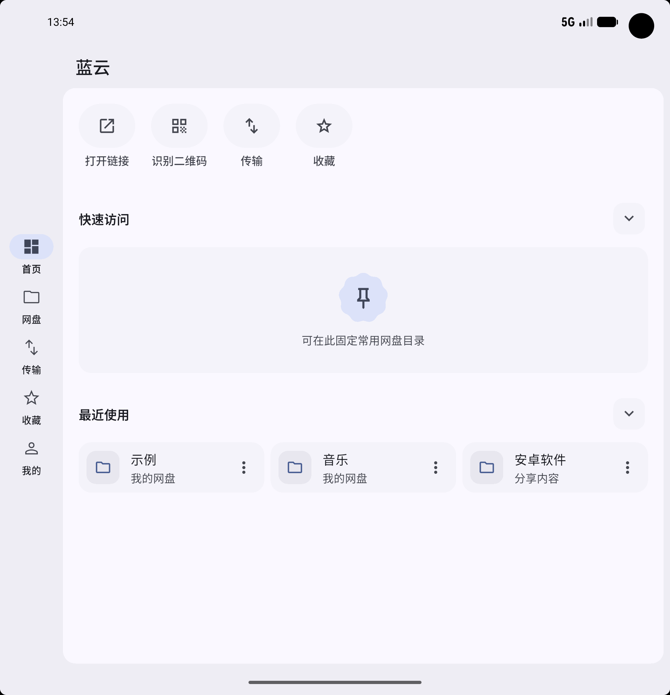
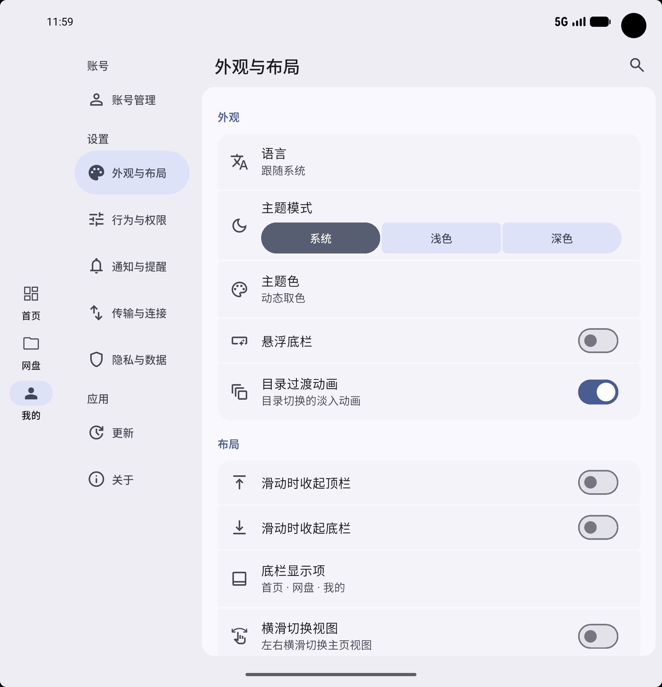
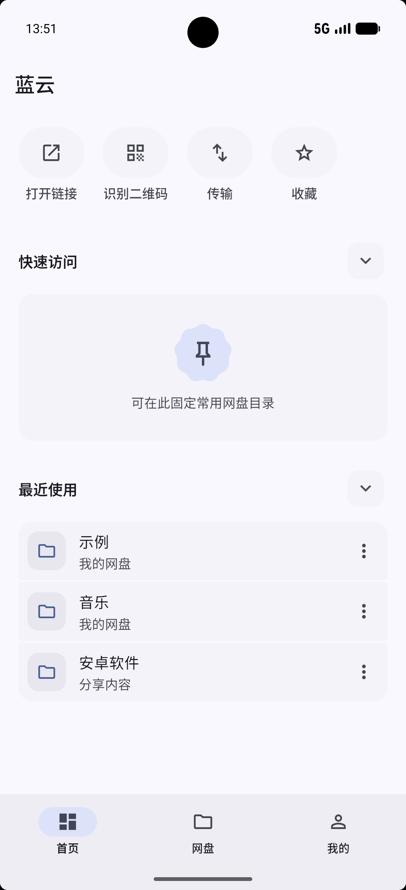
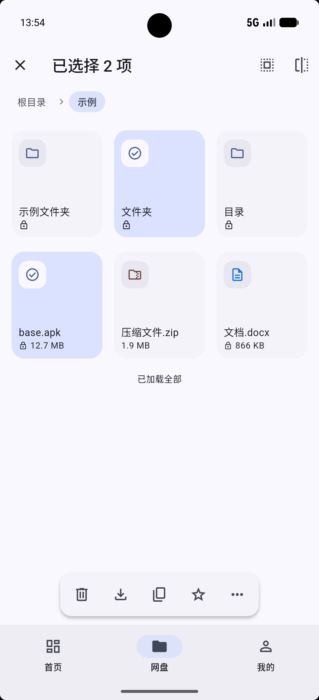
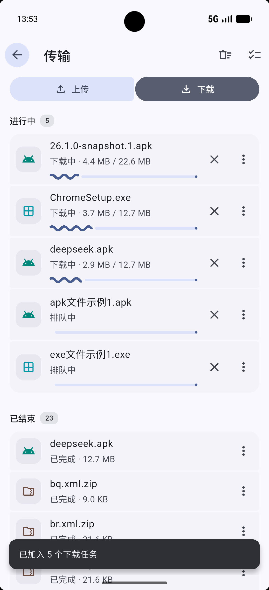
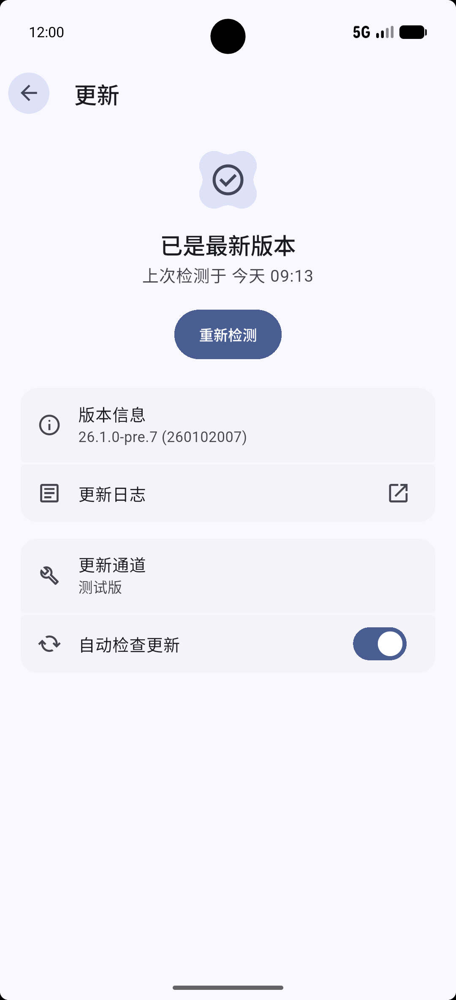

# LanCloud（蓝云）

蓝奏云第三方 Flutter 客户端，使用 DeepSeek + Codex 辅助开发与验证。

<div align="center">
&nbsp;

<br/>
&nbsp;
&nbsp;
&nbsp;

</div>

## 功能

- **MD 3 设计**：表现力设计、动态取色、自适应布局、悬浮底栏
- **网盘管理**：上传、下载、分享、新建文件夹、修改信息、移动、删除、搜索、排序
- **分享链接**：支持打开蓝奏云分享链接
- **多账号**：多账号支持
- **便利功能**：收藏 / 快速访问 / 最近使用
- **无障碍**：应用已尝试进行无障碍功能优化，敬请反馈以帮助改进
- **传输中心**：上传、下载任务管理，支持多任务
- **备份与恢复**：本地备份 + WebDAV 自动备份
- **Android 集成**：可接收其他应用分享的链接 / 文件；适配 Android 12 启动屏与预测性返回手势
- **Windows 集成**：可把文件拖进窗口上传；系统通知框架

## 平台

- [x] **Android** `7+`
- [x] **Windows** `10 1809 17763+`
- [ ] HarmonyOS NEXT `早期技术验证阶段`
- [ ] 其余平台无计划

> HarmonyOS NEXT 未来数月将维持搁置状态。因目前 Flutter OpenHarmony 适配的[主要社区](https://atomgit.com/CPF-Flutter/flutter_flutter)暂未适配 Flutter 3.47，而社区分支版本经测试性能表现欠佳，且无法对齐部分关键功能。

## 仓库结构

```text
.
├─ lib/                 应用源码（core / ui / l10n）
├─ test/                单元与组件测试
├─ tool/                Dart 仓库工具，由 dart run 调用
├─ tools/               Windows 开发、构建与发布脚本
├─ .github/             Workflow、复合 Action 与 Release 分类
├─ android/ windows/    产品构建平台
├─ ios/                 保留目录，当前不在验收范围
├─ assets/              图标、截图等应用资源
└─ docs/                架构、协议、版本与发布说明
```

`build/`、`outputs/`、`refs/` 和 `.dart_tool/` 都是本地生成或引用内容，不属于
源码结构。更详细的模块职责见 [docs/ARCHITECTURE.md](docs/ARCHITECTURE.md)。

## 获取

可以从 [Releases](https://github.com/Tgaisen/LanCloud/releases) 下载，或克隆仓库后自行编译。

- **Android**：优先选择 `arm64-v8a`；旧设备选 `armeabi-v7a`；模拟器选 `x86_64`。
- **Windows**：目前提供便携版 `x64_portable`，需下载解压后使用；运行需要 [WebView2 运行时](https://developer.microsoft.com/zh-cn/microsoft-edge/webview2/)，如缺乏，则无法打开网页登录 / 分享浏览等内嵌网页。

## 构建

### 版本号规范

细节见 [docs/VERSIONING.md](docs/VERSIONING.md)。

### 开发工具链

日常分析与测试统一通过项目入口执行；它会固定 Flutter、JDK 和 Android SDK
环境：

```powershell
tools\agent.cmd help
tools\agent.cmd pub-get
tools\agent.cmd format
tools\agent.cmd analyze
tools\agent.cmd test
```

### Android

```powershell
# 快速本地编译，默认 debug
tools\agent.cmd build-android

# 正式拆分 APK、复制到 outputs 并校验签名
tools\agent.cmd package-android

# 按已连接设备的 ABI 安装
tools\agent.cmd install-build-android
tools\agent.cmd install-package-android
```

`package-android` 会校验 release 签名指纹；本地签名材料准备方式见
[docs/CI_RELEASE.md](docs/CI_RELEASE.md)。

本仓库的 Android 签名公钥如下，可验证是否为本仓库产物：

```
70:BD:4A:A8:53:22:FE:26:E6:72:02:FA:C3:17:29:BD:E1:F8:54:FA:1B:D2:FD:52:C8:8F:FC:AA:02:ED:B5:BB
```

### Windows

```powershell
# 快速本地编译，默认 debug
tools\agent.cmd build-windows

# 正式生成 x64 portable 包
tools\agent.cmd package-windows
```

### 发布

细节见 [docs/CI_RELEASE.md](docs/CI_RELEASE.md)。

## 开源与致谢

本项目使用 DeepSeek + Codex 辅助开发与验证。

<div>
</img>
<br><br>
</div>

本项目以 Apache License 2.0 开源。

此项目的接口协议研究参考了以下开源实现：

- [LanZouCloud-API](https://github.com/zaxtyson/LanZouCloud-API)（MIT）
- [lanzouyun-disk](https://github.com/chenhb23/lanzouyun-disk)（MIT）
- [lanzouplus](https://github.com/nekobyran/lanzouplus)（MIT）

细节见 [docs/PROTOCOL.md](docs/PROTOCOL.md)。

## 免责声明

> 本应用是非官方的第三方客户端，与蓝奏云官方无任何关联，也未获得官方授权。应用按「现状」提供，不提供任何担保；因使用本应用造成的账号受限、数据丢失、上传或下载失败等风险，由使用者自行承担。请勿将其用于商业用途或大规模分发。

## 开发环境

| 组件 | 信息 |
| --- | --- |
| Flutter | 3.50.0 |
| JDK | 17 |
| Android SDK | platform 37、build-tools、NDK 28.2、CMake |
| Visual Studio Build Tools | 2026（Windows SDK 10.0.28000）；勾选「使用 C++ 的桌面开发」工作负载（含 Windows SDK 与 CMake），与「C++ ATL for x64/x86 (最新 MSVC)」 |
| Windows 开发者模式 | Flutter 构建插件创建符号链接所需 |
| NuGet CLI | 拉取 WebView2 SDK 所需 |
