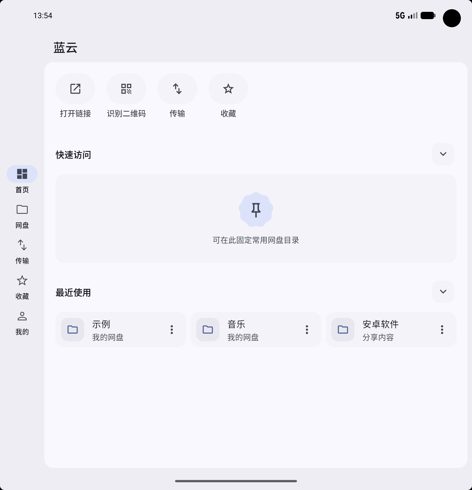
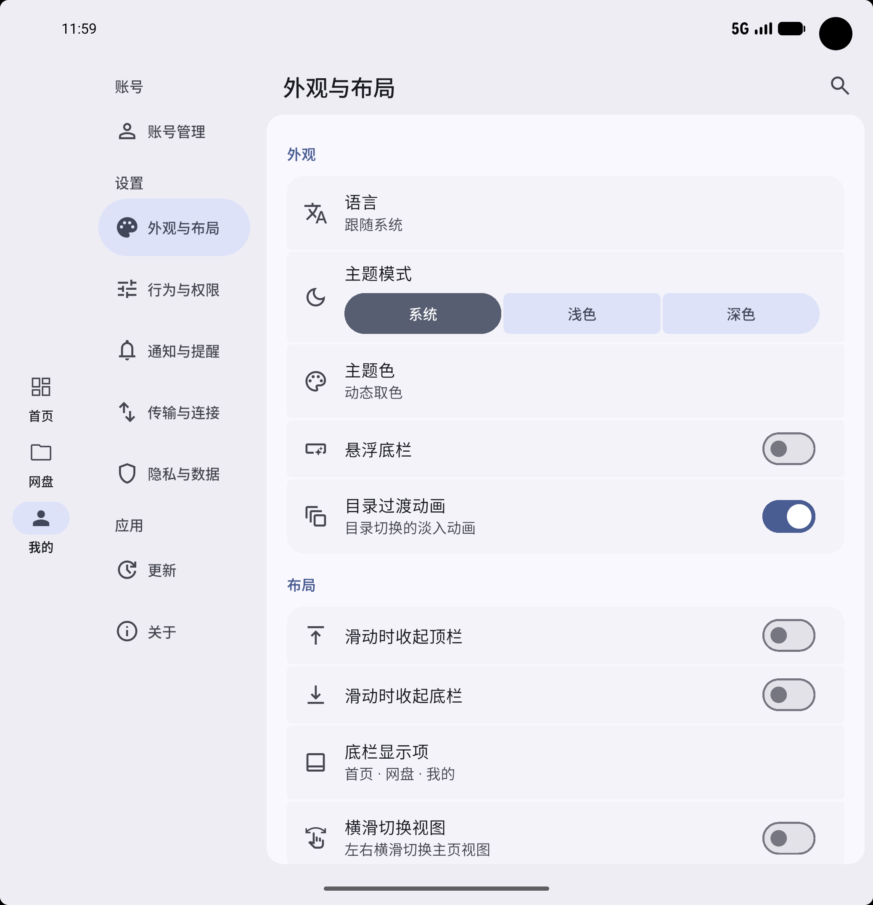
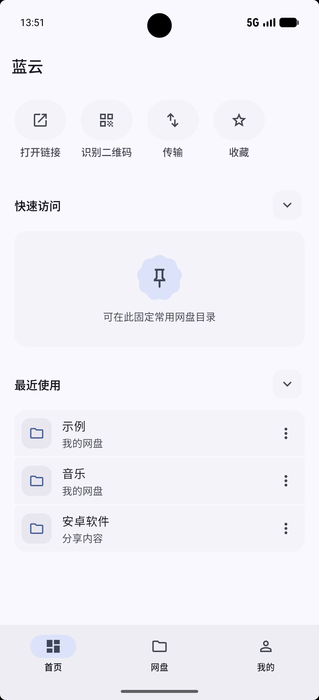
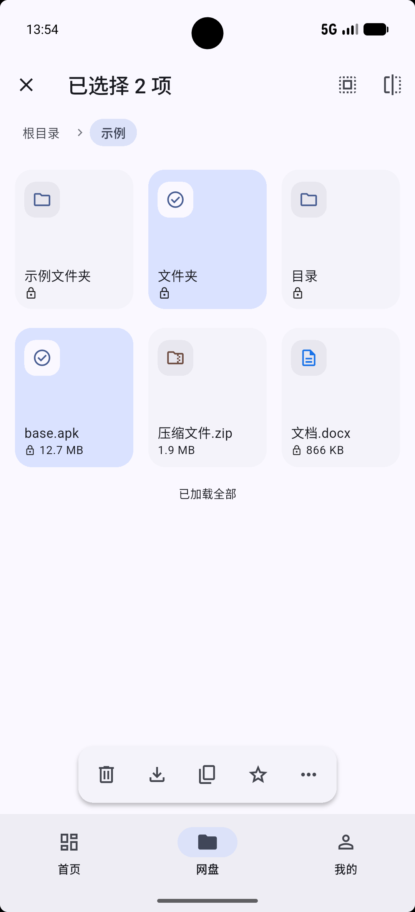
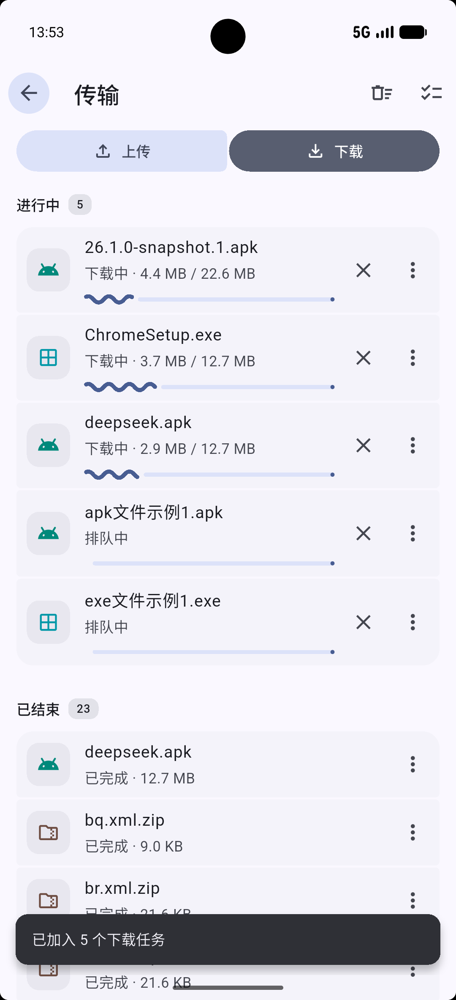
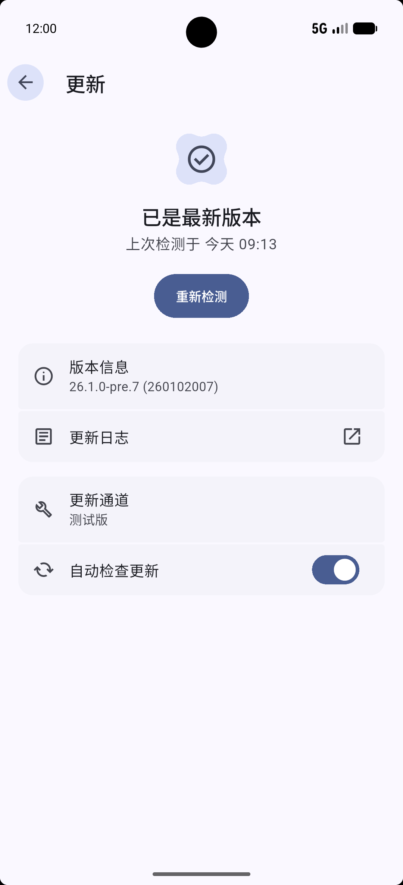

# LanCloud（蓝云）

蓝奏云第三方 Flutter 客户端，使用 DeepSeek + Codex 辅助开发与验证。

<div align="center">
&nbsp;

<br/>
&nbsp;
&nbsp;
&nbsp;

</div>

## 功能

- **MD 3 设计**：表现力设计、动态取色、自适应布局、悬浮底栏
- **网盘管理**：上传、下载、分享、新建文件夹、修改信息、移动、删除、搜索、排序
- **分享链接**：支持打开蓝奏云分享链接
- **多账号**：多账号支持
- **便利功能**：收藏 / 快速访问 / 最近使用
- **传输中心**：上传、下载任务管理，支持多任务
- **备份与恢复**：本地备份 + WebDAV 自动备份
- **Android 集成**：可接收其他应用分享的链接 / 文件；适配 Android 12 启动屏与预测性返回手势
- **Windows 集成**：可把文件从资源管理器拖进窗口上传；系统通知框架

## 平台

- [x] **Android** `7+`
- [x] **Windows** `10 1809 17763+`
- [ ] HarmonyOS NEXT（暂无计划，请使用卓易通）
- 其余平台无计划

## 获取

可以从 [Releases](https://github.com/Tgaisen/LanCloud/releases) 下载，或克隆仓库后自行编译。

- Android：优先选择 `arm64-v8a`；旧设备选 `armeabi-v7a`；模拟器选 `x86_64`。
- Windows：目前提供便携版 `x64_portable`，需下载解压后使用。

## 构建

### 版本号规范

版本号为： `年份(YY).内容更新序号(Drop).热修号(Hotfix)[-阶段(Stage).序号(Seq)]`

Android versionCode 规则： `YY * 10_000_000 + Drop * 100_000 + Hotfix * 10_000 + Stage * 1_000 + Seq`

| 阶段 | Stage | Seq | 版本号示例 | versionCode 示例 |
| --- | --- | --- | --- | --- |
| 快照 | `snapshot` = 1 | 1–999 | `26.1.0-snapshot.1` | `260101001` |
| 预览 | `pre` = 2 | 1–999 | `26.1.0-pre.1` | `260102001` |
| 候选 | `rc` = 3 | 1–999 | `26.1.0-rc.1` | `260103001` |
| 正式 | 9 | 999 | `26.1.0` | `260109999` |

### Android

```powershell
flutter pub get
flutter build apk --release --split-per-abi
```

#### 签名

本仓库的 Android 签名公钥如下，可验证是否为本仓库产物：

```
70:BD:4A:A8:53:22:FE:26:E6:72:02:FA:C3:17:29:BD:E1:F8:54:FA:1B:D2:FD:52:C8:8F:FC:AA:02:ED:B5:BB
```

### Windows

```powershell
powershell -ExecutionPolicy Bypass -File tools/build_windows.ps1
```

> 运行需要 WebView2 运行时，如缺乏，则无法打开网页登录 / 分享浏览等内嵌网页。

## 开源与致谢

本项目使用 DeepSeek + Codex 辅助开发与验证。

<div>
</img>
</div>

本项目以 Apache License 2.0 开源。

此项目的接口协议研究参考了以下开源实现：

- [LanZouCloud-API](https://github.com/zaxtyson/LanZouCloud-API)（MIT）
- [lanzouyun-disk](https://github.com/chenhb23/lanzouyun-disk)（MIT）
- [lanzouplus](https://github.com/nekobyran/lanzouplus)（MIT）

细节见 [docs/PROTOCOL.md](docs/PROTOCOL.md)。

## 免责声明

> 本应用是非官方的第三方客户端，与蓝奏云官方无任何关联，也未获得官方授权。应用按「现状」提供，不提供任何担保；因使用本应用造成的账号受限、数据丢失、上传或下载失败等风险，由使用者自行承担。请勿将其用于商业用途或大规模分发。

## 开发环境

| 组件 | 信息 |
| --- | --- |
| Flutter | 3.47.5 |
| JDK | 17 |
| Android SDK | platform 37、build-tools、NDK 28.2、CMake |
| Visual Studio Build Tools | 2026（Windows SDK 10.0.28000）；勾选「使用 C++ 的桌面开发」工作负载（含 Windows SDK 与 CMake），与「C++ ATL for x64/x86 (最新 MSVC)」 |
| Windows 开发者模式 | Flutter 构建插件创建符号链接所需 |
| NuGet CLI | 拉取 WebView2 SDK 所需 |
